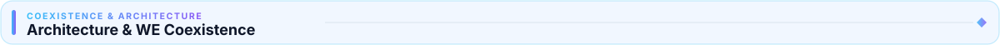
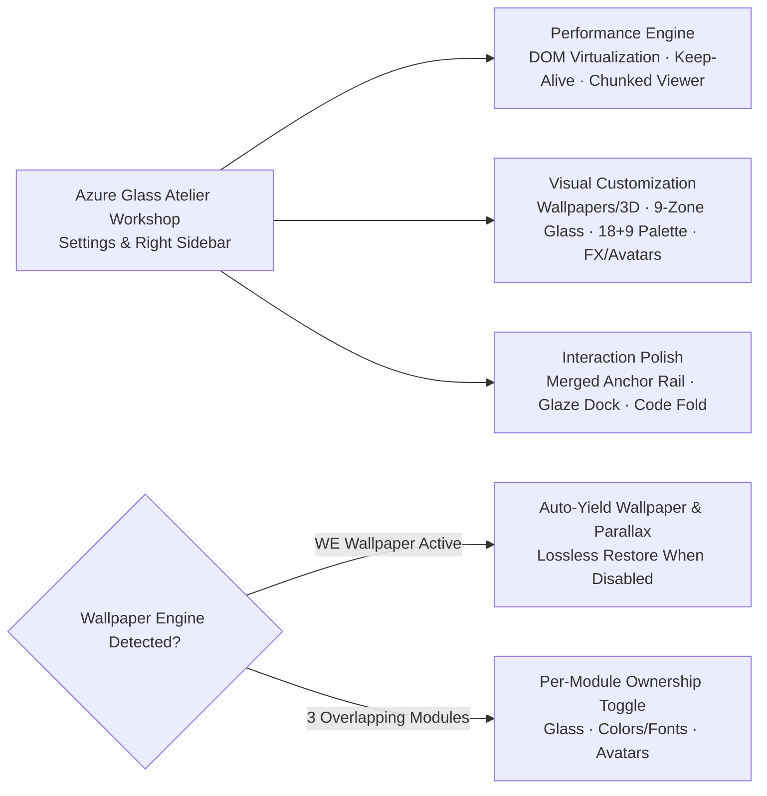

<div align="center">

<p>🌐 &nbsp; <a href="README.md">简体中文</a> &nbsp;·&nbsp; <strong>English</strong></p>

<picture>
  <source media="(prefers-color-scheme: dark)" srcset="assets/readme/hero-en-dark.svg?v=3">
  
</picture>

<p>
  <a href="https://github.com/A16Nights/dsh-azure-glass/releases"></a>
  <a href="https://github.com/A16Nights/dsh-azure-glass/stargazers"></a>
  
  
  <a href="./LICENSE"></a>
</p>

<p>
  <strong>All-in-one DeepSeek Harness (DSH) Workshop — Performance Engine × Frosted Glass Aesthetics × Productivity Suite × Context Observer</strong>
</p>

<p>
  <a href="#features">✨ Features</a> &nbsp;·&nbsp;
  <a href="#coexist">🤝 Coexistence &amp; Architecture</a> &nbsp;·&nbsp;
  <a href="#installation">🚀 Quick Start</a> &nbsp;·&nbsp;
  <a href="#security">🔒 Local &amp; Security</a>
</p>

</div>

> [!WARNING]
> **Early Beta Release (v0.2.2 Beta)**
> This plugin is under active development; some features, config schemas, and UI details may evolve. Bug reports and feature ideas are welcome in [Issues](https://github.com/A16Nights/dsh-azure-glass/issues).

**Azure Glass Atelier (`dsh-azure-glass`)** ships with zero build dependencies and dual workshop entry points (**Settings Page** + **Right Sidebar**), combining smooth long-conversation performance, desktop-grade frosted glass visual customization, skin & plugin update management, built-in productivity addons, and a live context observer.

<table>
<tr>
<td width="50%" valign="top">
<h4>⚡ Performance Engine &amp; Large-File Viewer</h4>
Viewport DOM virtualization for long threads, background session keep-alive &amp; hover preloading, auto-pause when unfocused, and streaming chunked preview for <code>&gt;5 MB</code> files.
</td>
<td width="50%" valign="top">
<h4>🖼️ Wallpaper Library, Live FX &amp; 3D Parallax</h4>
Local images, MP4/WebM video wallpapers, or URLs (12-slot local library), dual empty/active blur levels, dual-tone ambient Glow, animated Topo contours, and mouse 3D parallax.
</td>
</tr>
<tr>
<td width="50%" valign="top">
<h4>🪟 9-Zone Frosted Glass &amp; Preset Library</h4>
Independent blur radius and opacity controls across 9 UI zones (with one-click solid high-contrast mode for overlays &amp; Diff views), plus personal preset saving &amp; switching.
</td>
<td width="50%" valign="top">
<h4>🎨 18+9 Granular Palette &amp; Dual-Tone Studio</h4>
5 built-in themes, 18 UI semantic colors, 9 Markdown typography colors, font/size controls, and a dual-tone workshop theme center with 4 personal slots.
</td>
</tr>
<tr>
<td width="50%" valign="top">
<h4>📑 Merged Anchor Rail &amp; 🫧 Glaze Dock</h4>
Antigravity-style merged conversation anchor rail (left/right docking + hover preview jump), auto-folding long code blocks, and a compact pop-up dock for bottom toolbar buttons.
</td>
<td width="50%" valign="top">
<h4>✨ Neon Click/Trail FX &amp; Custom Avatars</h4>
6 click effects + 2 cursor trails (theme-synced, rainbow, or custom color), plus independent User/Assistant avatar libraries with a built-in 1:1 crop studio and raw GIF support.
</td>
</tr>
</table>

<h2 id="features">
<picture>
  <source media="(prefers-color-scheme: dark)" srcset="assets/readme/sec-features-en-dark.svg">
  
</picture>
</h2>

### ⚡ 1. Performance Engine & Large-File Acceleration
- **Viewport DOM Virtualization**: Automatically unmounts off-screen historical messages while preserving exact height placeholders, with configurable buffer multipliers and tail keep-alive counts—never interrupting streaming output or syntax highlighting.
- **Live Performance Telemetry**: Displays active rendered nodes, sleeping nodes, and collapsed code block counts right inside the workshop.
- **Multi-Layer Power & Load Reduction**: Native image lazy loading, automatic pause on window blur/background, dynamic frosted-glass downgrade during fast scrolling, ultra-performance mode, and ghost-spacing / settings scroll polish.
- **Multi-Session Keep-Alive & Pre-Warming**: Configure max background keep-alive sessions, startup pre-warm count, and sidebar hover preloading for instant thread switching.
- **Large-File Streaming Viewer**: Automatically activates streaming chunked preview in the right sidebar for logs or source files over 5 MB with page jump and index refresh.

### 🖼️ 2. Wallpaper Library, Procedural Backgrounds & 3D Parallax
- **Multi-Source Wallpapers**: Local static images, local MP4/WebM videos (with mute toggle and volume slider), and remote URLs.
- **Local 12-Slot Wallpaper Library**: Thumbnail cards for one-click switching and double-confirmed deletion; all assets remain strictly local.
- **Fine Framing & Lighting**: `cover` / `contain` / `auto` sizing, X/Y offsets, scale, opacity, brightness, and saturation sliders.
- **Dual Smart Blur & Dimming Veil**: Independent blur radii for empty vs. active chat views plus a dimming overlay for crisp readability.
- **Procedural Live Backgrounds** (standalone or layered over wallpapers): **Ambient Dual-Tone Glow** and **Flowing Topographic Contours (Topo)**.
- **Mouse 3D Parallax**: Configurable parallax amplitude with optional subtle UI follow-through.

### 🪟 3. 9-Zone Frosted Glass & Custom Preset Library
- **Global Surface Controls**: Master glass switch, saturation boost, border highlight opacity, global corner radius, and minimalist thin scrollbars.
- **Independent 9-Zone Controls**: Tune blur radius and opacity individually for the **Top Header** (with transparent toggle), **Left Sidebar & Primary Surfaces**, **Main Chat Canvas**, **Right Sidebar Panel**, **Main Composer**, **Side Composer** (with right-margin tuning), **Message Bubbles**, **Overlays & Modals** (one-click solid high-contrast), and **Code Diff Views** (one-click solid high-contrast).
- **Personal Preset Library**: Save your entire glass + color configuration as named presets for instant switching.

### 🎨 4. Color Typography & Azure Glass Atelier Theme Center
- **Built-in Color Themes**: Follow System, Azure Mirage, Mariana Deep, Sakura Soft, and Midnight Violet-Gold.
- **Full Granular Palette**:
  - **18 UI Semantic Colors**: Canvas, 3 surface tiers, sidebar, menus, accent & accent-text, 3 text tiers & links, 2 border tiers, hover/selection, user bubble, and code blocks;
  - **9 Markdown Typography Colors**: Headings/tables, bold, italic, inline code, list markers, blockquote text/bar, body links, and strikethrough, with Off / Soft / Vivid contrast boost;
  - **Process Rows & Caret**: Dedicated colors for tool-call rows, process summaries, file cards, and composer caret.
- **Typography Customization**: Body font presets & custom fonts, monospace code font, body size, line height, and code font size.
- **Workshop Dual-Tone Theme Center**: Built-in *Azure Starlight* and *Starry Dark Violet* themes, custom A/B dual colors with one-click swap, 4 personal slots, plus header DSH light/dark switch and GitHub update checker.

### 📑 5. Antigravity Layout & 🫧 Glaze Dock
- **Antigravity-Style Merged Anchor Rail**: Left/right dockable navigation rail showing individual dots for recent N turns and merged blocks for earlier turns, with hover quick-preview cards and accurate jump-to-turn.
- **Chapter Outline & Quick Capsule**: Lightweight top navigation capsule for jumping across long sessions.
- **Auto-Fold Long Code Blocks**: Set a maximum visible height for code blocks with one-click expand/collapse.
- **Chat Ergonomics**: Custom max chat width, smooth streaming auto-scroll, and auto-collapsing composer.
- **🫧 Glaze Dock**: Neatly packs bottom composer plugin buttons into a clean upward pop-up drawer with per-button placement toggles (Dock vs. Original).

### ✨ 6. Neon Click/Trail Effects & Custom Chat Avatars
- **6 Click Effects**: Ripple + Sparks, Double Neon Ripple, Burst Sparks, Starburst Fireworks, Falling Petals, and Floating Hearts.
- **2 Cursor Trails**: Glowing Comet Tail and Twinkling Stardust.
- **Customizable Appearance**: Theme dual-tone / Rainbow / Custom color modes, scale, glow intensity, opacity, and 4 blend modes (Screen / Normal / Lighten / Overlay).
- **Custom User & Assistant Avatars**: Local images, animated GIFs (raw pass-through option), or URLs, with a built-in **1:1 interactive crop studio** and separate User / Assistant avatar libraries.

<h2 id="coexist">
<picture>
  <source media="(prefers-color-scheme: dark)" srcset="assets/readme/sec-coexist-en-dark.svg">
  
</picture>
</h2>



### 🤝 Deep Coexistence with Wallpaper Engine
- **Zero-Clutter Auto-Detection**: Coexistence controls appear automatically only when `dsh-plugin-wallpaper-engine` is installed.
- **Automatic Wallpaper Yielding**: Pauses Azure Glass Atelier's own wallpaper & 3D parallax whenever a Wallpaper Engine wallpaper is active, restoring seamlessly once disabled.
- **Per-Module Ownership Toggles**: Independently choose whether **Azure Glass Atelier** or **Wallpaper Engine** owns **Frosted Glass**, **Colors / Fonts / Caret**, and **Custom Avatars**—preventing conflicting styles cleanly.

<h2 id="install">
<picture>
  <source media="(prefers-color-scheme: dark)" srcset="assets/readme/sec-install-en-dark.svg">
  
</picture>
</h2>

### Option 1 · Let Your DSH Agent Install It (Recommended)

Send this prompt directly to your DSH Agent:

> Please install `github:A16Nights/dsh-azure-glass` via the DSH plugin CLI, verify the installation, and let me know once it is ready so I can restart DSH.

### Option 2 · Install via DSH CLI

```bash
dsh plugin add github:A16Nights/dsh-azure-glass
```

### Option 3 · Add Manually to Profile `package.json`

Add the following to both `dependencies` and `dsh.profile.bundles`:

```json
"dsh-azure-glass": "github:A16Nights/dsh-azure-glass"
```

Restart DSH and open the workshop from **Settings → Azure Glass** or **Right Sidebar → Azure Glass**. Click the version badge at the top-right of the workshop to check for GitHub updates anytime.

<h2 id="security">
<picture>
  <source media="(prefers-color-scheme: dark)" srcset="assets/readme/sec-security-en-dark.svg">
  
</picture>
</h2>

<details open>
<summary><strong>Click to inspect Custom CSS, local data isolation &amp; security design</strong></summary>

<br>

- **Custom CSS Injection**: Built-in CSS editor with an independent master switch and instant hot-reload.
- **100% Local Assets & Settings**: All settings, presets, wallpapers, and avatars live in your local DSH plugin data directory—never synced with source code or uploaded externally.
- **Same-Origin Auth & Workspace Guard**: Backend routes enforce DSH session authentication and same-origin loopback checks, and large-file streaming is strictly sandboxed to the active conversation workspace.

</details>

---

<div align="center">

📄 Released under the <a href="./LICENSE"><strong>MIT License</strong></a> · Crafted for <strong>DeepSeek Harness (DSH)</strong>

</div>
