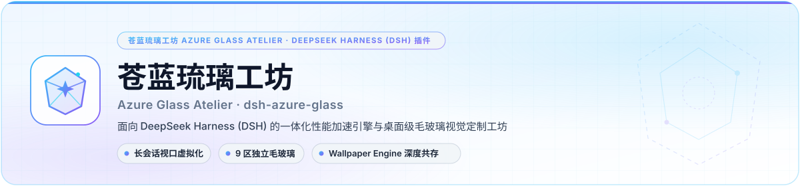
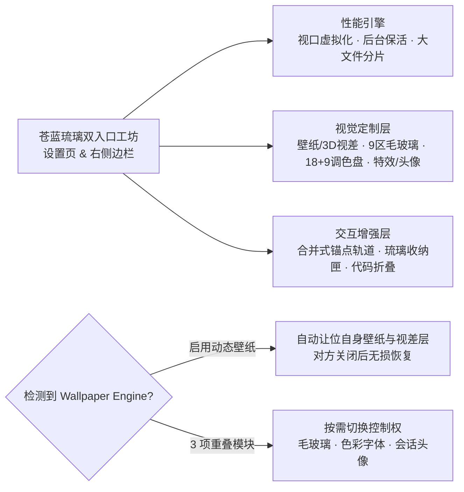

<div align="center">

<p>🌐 &nbsp; <strong>简体中文</strong> &nbsp;·&nbsp; <a href="README.en.md">English</a></p>

<picture>
  <source media="(prefers-color-scheme: dark)" srcset="assets/readme/hero-dark.svg">
  
</picture>

<p>
  <a href="https://github.com/A16Nights/dsh-azure-glass/releases"></a>
  <a href="https://github.com/A16Nights/dsh-azure-glass/stargazers"></a>
  
  
  <a href="./LICENSE"></a>
</p>

<p>
  <strong>面向 DeepSeek Harness (DSH) 桌面端 / Web 端的一体化性能加速与桌面级视觉美化插件</strong>
</p>

<p>
  <a href="#features">✨ 功能全景</a> &nbsp;·&nbsp;
  <a href="#coexist">🤝 共存与架构</a> &nbsp;·&nbsp;
  <a href="#installation">🚀 快速安装</a> &nbsp;·&nbsp;
  <a href="#security">🔒 本地与安全</a>
</p>

</div>

> [!WARNING]
> **当前处于早期测试阶段（v0.1.3 Beta）**
> 本插件仍在持续迭代与打磨中，部分功能、配置结构与界面细节可能会在后续版本中调整。如遇到问题或有改进建议，欢迎在 [Issues](https://github.com/A16Nights/dsh-azure-glass/issues) 反馈。

**苍蓝琉璃（`dsh-azure-glass`）** 采用零构建依赖设计，开箱即用，提供 **「设置页」** 与 **「右侧边栏」** 双入口工坊面板，兼顾超长对话的丝滑流畅度与高度自由的桌面级毛玻璃视觉定制。

<table>
<tr>
<td width="50%" valign="top">
<h4>⚡ 性能引擎与大文件极速查看</h4>
长会话视口 DOM 虚拟化、多会话后台保活与悬停预热、窗口失焦自动节能，以及 <code>&gt;5 MB</code> 超大日志/源码流式分片只读预览。
</td>
<td width="50%" valign="top">
<h4>🖼️ 壁纸库、动态背景与 3D 视差</h4>
支持本地图片 / MP4·WebM 视频 / 网络 URL（12 槽位本地壁纸库）、空页/正文双档智能模糊、双色氛围光晕、流动等高线与鼠标 3D 视差。
</td>
</tr>
<tr>
<td width="50%" valign="top">
<h4>🪟 9 区独立毛玻璃 &amp; 个人预设库</h4>
9 大界面区域独立调节模糊半径与不透明度（浮层与代码 Diff 支持一键切纯实色高对比），一键保存、切换与管理个人质感预设。
</td>
<td width="50%" valign="top">
<h4>🎨 18+9 细粒度调色盘与琉璃主题</h4>
5 套内置配色 + 18 项 UI 语义色 + 9 项 Markdown 排版色 + 字体字号定制；工坊自带双色主题中心与 4 个个人保存槽位。
</td>
</tr>
<tr>
<td width="50%" valign="top">
<h4>📑 合并式锚点轨道 &amp; 🫧 琉璃收纳匣</h4>
Antigravity 风格合并式会话锚点轨道（支持左/右侧停靠与悬停速览跳转）、超长代码块自动折叠，以及底部插件按钮收纳浮层。
</td>
<td width="50%" valign="top">
<h4>✨ 霓虹点击/拖尾特效 &amp; 自定义头像</h4>
6 种点击光效 + 2 种移动拖尾（支持主题双色/彩虹/单色），以及内置 1:1 裁切工作台的用户/助手独立头像库（支持 GIF 动图直传）。
</td>
</tr>
</table>

<h2 id="features">
<picture>
  <source media="(prefers-color-scheme: dark)" srcset="assets/readme/sec-features-dark.svg">
  
</picture>
</h2>

### ⚡ 1. 性能引擎与大文件加速
- **长会话视口 DOM 虚拟化**：自动裁剪视口外历史消息并保留精确高度占位，支持自定义缓冲区视口倍数与尾部常驻保活条数，不干扰流式输出与代码高亮。
- **实时性能状态监测**：在工坊内直观展示当前会话渲染节点数、休眠节点数与折叠代码块统计。
- **多维减负与节能策略**：支持图片原生懒加载、窗口失焦/后台自动暂停特效与渲染任务、快速滚动时动态毛玻璃降级、极速性能模式，以及空白幽灵间距与设置页滚动体验优化。
- **多会话后台保活与预热**：可自定义最大后台保活会话数量、启动预热会话数与侧栏悬停预加载，切换长对话秒开不白屏。
- **右侧边栏大文件极速查看**：对超过 5 MB 的大型日志或源码文件自动启用流式分片预览，支持页码跳转、刷新索引与只读极速浏览，防止页面卡死。

### 🖼️ 2. 壁纸库、动态背景与 3D 视差
- **多源壁纸支持**：支持本地静态图片、本地视频壁纸（MP4 / WebM，提供独立静音开关与音量调节）以及网络 URL。
- **内置本地壁纸库**：最多保存 12 张本地壁纸，缩略图卡片一键切换，支持二次确认删除，全部素材仅保存在本机。
- **精细构图与光影调节**：支持铺满裁剪（`cover`）/ 完整居中（`contain`）/ 原始尺寸（`auto`），以及 X/Y 位置偏移、缩放比例、不透明度、亮度、饱和度调节。
- **双档智能模糊与压暗遮罩**：可分别为「空对话页」和「有对话内容」设置不同的壁纸模糊半径，配合背景压暗遮罩，兼顾观赏性与正文可读性。
- **程序化动态背景特效**（可独立使用或与壁纸叠加）：
  - **双色氛围光晕（Glow）**：自定义双色渐变、不透明度与光晕角度；
  - **流动等高线地形（Topo）**：自定义线条色彩、不透明度、密度与流动速度。
- **鼠标 3D 视差**：支持自定义视差移动幅度，并可选开启 UI 轻微联动跟随。

### 🪟 3. 分区毛玻璃质感与预设管理
- **全局质感控制**：提供毛玻璃总开关、色彩饱和度、边框高光透明度、全局圆角半径与极简细滚动条开关。
- **按区域精细独立调节**：可分别调节以下 9 个区域的模糊半径与不透明度：
  - 顶部标题栏（支持独立透明开关）
  - 左侧栏与一级通用表面
  - 聊天主区背景
  - 右侧边栏面板
  - 主对话输入框
  - 侧边对话输入框（另支持自定义右侧留白间距）
  - 消息气泡
  - 浮层与弹窗（支持一键切为纯实色高对比模式）
  - 代码 Diff 对比区域（支持一键切为纯实色高对比模式）
- **自定义质感与配色预设库**：支持将当前整套毛玻璃与色彩参数一键保存为个人预设，随时快速切换或删除。

### 🎨 4. 色彩排版与琉璃 UI 主题中心
- **多套内置界面配色主题**：跟随系统默认、苍蓝幻境（Azure）、Mariana 深海、樱粉柔光、极夜紫金。
- **全量细粒度调色盘**：
  - **18 项 UI 语义色**：主画布、一/二/三级表面、左侧栏、菜单弹窗、主强调色与强调文字色、三级正文与超链接色、一/二级边框、悬停/选中底色、用户消息气泡底色、代码块底色；
  - **9 项 Markdown 正文排版色**：标题/表头、加粗、斜体、行内代码、列表标记、引用文字、引用竖线、正文链接、删除线，支持「关闭 / 柔和提亮 / 鲜明提亮」三档对比度增强；
  - **过程行与光标专属配色**：独立定制工具调用行、过程摘要行、文件卡片行高亮色以及输入框光标色。
- **字体与排版定制**：支持预设及自定义正文字体（默认/雅黑/楷体/宋体/黑体/等宽）、等宽代码字体、正文字号、行高与代码字号。
- **琉璃工坊自身双色主题中心**：内置「苍蓝星辉」「星雾黑紫」双色主题，支持 A/B 双色自由定制、一键对调主辅色，并提供 4 个个人主题保存槽位。
- **顶栏快捷控制**：工坊顶栏集成 DSH 深浅色一键切换、工坊主题快捷切换与版本号在线检查更新按钮。

### 📑 5. Antigravity 布局与 🫧 琉璃收纳匣
- **Antigravity 风格合并式会话锚点轨道**：无缝接管对话导航，支持自由切换左/右侧停靠；最近 N 轮逐点展示、早期轮次按块自动合并，悬停弹出对话速览卡片，点击精准跳转。
- **章节大纲与快捷胶囊**：长对话顶部提供轻量化快捷导航入口，随时定位历史轮次。
- **超长代码块自动折叠 &amp; Mermaid 图示渲染**：自定义代码块最大展示高度并支持一键展开/收起；内置按需加载的 Mermaid 渲染引擎，自动将 `mermaid` 代码块原地渲染为流程图/时序图并随深浅色主题重绘。
- **对话交互增强**：支持自定义聊天主区最大宽度、流式输出丝滑滚底跟随、输入框自动收起。
- **🫧 琉璃收纳匣**：将对话输入框底部的各类插件按钮收纳进紧凑轻盈的向上展开浮层，在工坊内可按区域逐个决定每个控件放进「匣内」或保留在「原位」。

### ✨ 6. 霓虹点击/拖尾特效与自定义会话头像
- **6 种鼠标点击光效**：涟漪 + 星火（经典双效）、霓虹双环涟漪（Ripple）、爆裂星火流光（Sparks）、星芒烟花绽放（Starburst）、樱落飞舞花瓣（Petal）、微光上浮爱心（Heart）。
- **2 种鼠标移动拖尾**：发光彗尾（渐隐光带）、闪烁星尘（微粒飘散）。
- **特效外观高度可调**：支持「跟随琉璃主题双色 / 彩虹霓虹流转 / 自定义单色」3 种配色模式、尺寸缩放、发光强度、不透明度与 4 种混合模式（滤色 / 正常 / 变亮 / 叠加）。
- **自定义用户 / 助手会话头像**：
  - 支持本地上传图片、GIF 动图（可选原图直传以保留动画）与网络 URL；
  - 内置 **1:1 交互式头像裁切工作台**，支持拖拽定位、缩放与一键居中；
  - 独立的用户头像库与助手头像库，随时收藏、一键切换与移除。

### 🎭 7. 皮肤创意工坊
- **本地 DSH v2 皮肤库管理**：自动扫描本地 `~/.dsh/skins/` 皮肤包，支持预览图展示、一键切换应用、安全删除与标准 v2 `.zip` 皮肤包导入（内置防 Zip Slip 路径穿越保护，并强制忽略不安全的 `hooks.mjs`）。
- **8 套内置精选昼夜双色皮肤**：内置 Catppuccin Mocha、Tokyo Night、Nord、Rosé Pine、Dracula、Kanagawa、Everforest、Sakura 等 8 套经典主题，昼夜双色自适应、即点即用且不污染本地皮肤目录。
- **壁纸共存让位**：启用 Wallpaper Engine 动态壁纸时可自动剥离皮肤背景层，仅保留主题配色与细节样式。

### 🔌 8. 插件更新中心
- **全量第三方插件扫描与并发查新**：自动扫描当前 Profile 已安装的第三方插件，并发查询 npm 与 GitHub 仓库最新版本，支持按关键词检索、状态图标一键启停以及单个/全部批量更新。
- **双端灵活展示**：支持在「仅苍蓝琉璃内显示」与「同时挂载到官方插件页」之间自由切换，并兼容官方插件详情页原生插槽。
- **可复制更新清单卡片**：检查更新完成后弹出排版清晰的更新版本清单卡片，支持自由框选文本与「📋 一键复制」。

<h2 id="coexist">
<picture>
  <source media="(prefers-color-scheme: dark)" srcset="assets/readme/sec-coexist-dark.svg">
  
</picture>
</h2>



### 🤝 Wallpaper Engine 插件深度共存兼容
- **无感自动检测**：仅在检测到已安装 `dsh-plugin-wallpaper-engine` 时自动启用共存管理，未安装时界面保持纯净无多余选项。
- **动态壁纸自动让位**：当 Wallpaper Engine 壁纸启用时，苍蓝琉璃自动暂停自身壁纸与 3D 视差层，优先保证 Wallpaper Engine 动态壁纸正常显示；对方关闭壁纸后自动无损恢复。
- **重叠模块按需接管**：针对「分区毛玻璃」「对话输入框（独立控制）」「色彩、文本改色、字体与光标」「自定义会话头像」四项重叠功能，提供独立切换按钮：
  - 选择 **由苍蓝琉璃控制**：自动屏蔽 Wallpaper Engine 对应的重叠样式与节点；
  - 选择 **由 Wallpaper Engine 控制**：释放对方控制权，并将苍蓝琉璃对应控制区域柔和变灰并标注提示，避免样式互相打架。

<h2 id="install">
<picture>
  <source media="(prefers-color-scheme: dark)" srcset="assets/readme/sec-install-dark.svg">
  
</picture>
</h2>

### 方式一 · 一句话让 DSH Agent 帮你安装（推荐）

直接把下面这句话发给你的 DSH Agent：

> 帮我通过 DSH 插件命令安装 `github:A16Nights/dsh-azure-glass`（苍蓝琉璃插件），安装完成后告诉我，我再重启 DSH 生效。

### 方式二 · 通过 DSH CLI 安装

```bash
dsh plugin add github:A16Nights/dsh-azure-glass
```

### 方式三 · 在 Profile 中手动添加

在你的 DSH Profile `package.json` 的 `dependencies` 与 `dsh.profile.bundles` 中添加：

```json
"dsh-azure-glass": "github:A16Nights/dsh-azure-glass"
```

重启 DSH 后，可在 **设置 → 苍蓝琉璃** 或 **右侧边栏 → 苍蓝琉璃** 中打开工坊面板；点击工坊顶栏最右侧的版本号按钮即可在线检查 GitHub 新版本。

<h2 id="security">
<picture>
  <source media="(prefers-color-scheme: dark)" srcset="assets/readme/sec-security-dark.svg">
  
</picture>
</h2>

<details open>
<summary><strong>点击查看自定义 CSS、本地存储与安全访问机制</strong></summary>

<br>

- **自定义 CSS 注入**：内置样式代码编辑区与独立开关，修改后实时热生效。
- **配置与素材纯本地保存**：所有配置、个人预设、壁纸库与头像库均保存在本机 DSH 插件数据目录中，不会随插件源码同步或外传。
- **同源鉴权与工作区访问保护**：插件后端路由统一接入 DSH 会话鉴权与同源回环校验，大文件流式预览严格限制在当前会话工作区目录内。

</details>

---

<div align="center">

📄 Released under the <a href="./LICENSE"><strong>MIT License</strong></a> · Crafted for <strong>DeepSeek Harness (DSH)</strong>

</div>
